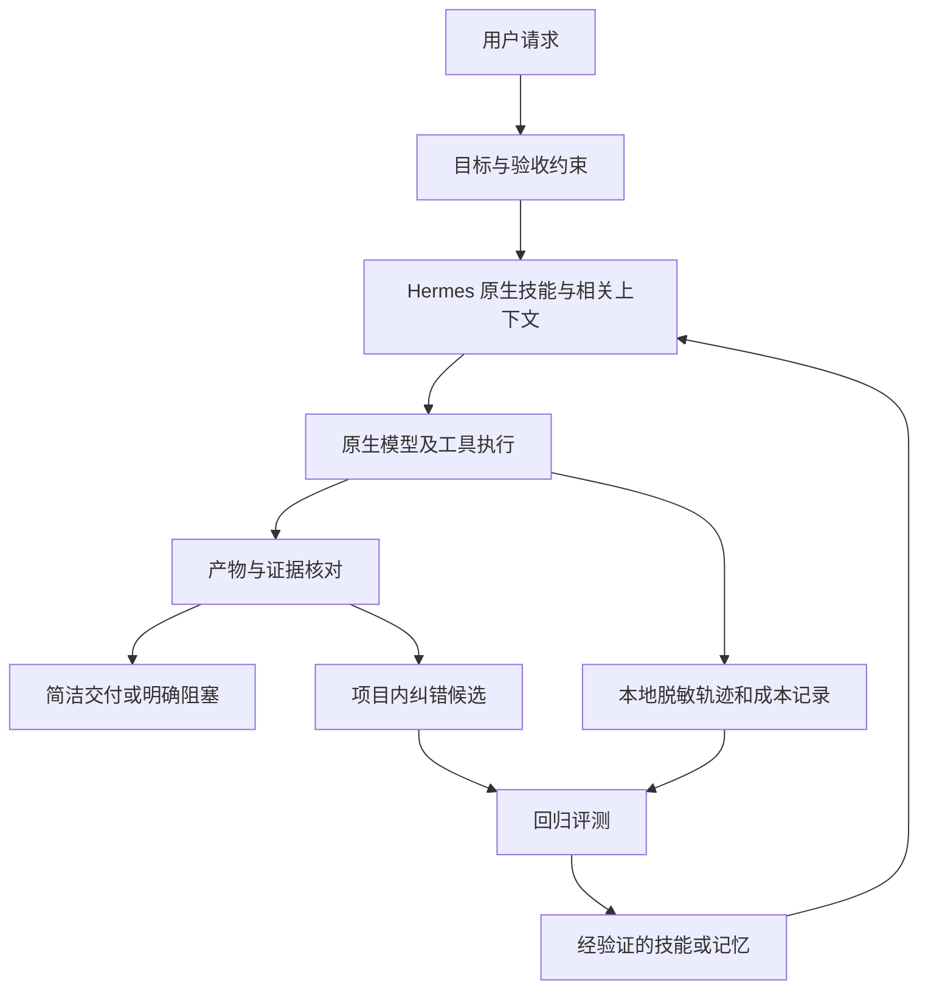

# 面向日常使用的优化方案

## 希望用户感受到的变化

| 使用情境 | 优化后应呈现的行为 | 成功判据 |
|---|---|---|
| 一句明确指令 | 直接推进，先给结果，需要时再补解释 | 不把已给信息再次当问题；简单任务无流程仪式 |
| 较复杂任务 | 一次确认真正影响结果的缺失约束，其他部分继续做 | 澄清数量下降，任务成功率不下降 |
| 长任务或换会话 | 延续目标、约束、已完成项与下一步 | 不重做已完成动作，不重复外部写入 |
| 出错或中断 | 说明卡在哪里、已有产物与可恢复步骤 | 不无限重试，不把未知结果当失败重做 |
| 用户纠正它 | 当前任务立刻纠正，稳定经验进入项目范围候选 | 类似错误复发减少，临时指令不污染长期偏好 |
| 说“完成” | 附可核对的文件、链接或验证结果 | 零虚假完成声明 |

## 最小架构

任务路由是轻量策略：简单问答不生成任务卡，不搜无关历史，不调多个模型。研究、长任务和可复用流程才调用对应技能。主模型默认保持一个稳定配置；按请求频繁切换容易失去缓存并增加不可预测性。

## 模块设计

### A. 目标与交付证据（P0）

复杂任务用 `templates/task-brief.md`。记录目标、现有授权、约束、验收和产物位置；已知项不再询问。实施前先核实本地环境可做什么。完成时区分“已生成”“已验证”“待集成”“受阻”，并给证据。

优先试用 `skills-drafts/evidence-delivery`，不修改 agent loop。低风险工作只做与任务相关的验证，避免要求所有任务运行全部测试。代码缺陷修复在本地 Claude Code 侧采用根因调试与针对性回归。

### B. 上下文与技能精简（P1）

先统计输入构成：固定提示、记忆、技能元数据/正文、工具 schema、历史、工具结果、检索文本、压缩摘要。优先减少重复规则和无关工具，不凭工具数量设一刀切上限。

主项目说明保留目标与索引，正文放 reference。技能以具体触发条件加载；默认不自动链式调用多个大型技能。大型工具结果保存为文件，返回摘要与定位信息；摘要不得丢掉错误、授权限制或关键数据。保护 system 消息、工具调用/结果配对和用户最新纠正。

先用原生工具筛选与压缩。确有缺口时再做 ContextEngine 插件：只选择请求上下文、不修改 transcript，明确超时、旧版本降级、缓存代价和回滚。

### C. 长任务连续性（P1）

`templates/task-handoff.md` 持久记录 task_id、目标、约束、产物、已验证事实、执行状态、待确认写入、下一动作。任务文件为任务状态载体，长期记忆只存跨任务稳定信息。示例路径由实施者选定，不伪装为 Hermes 内置配置项。

在自然阶段边界交接；压缩前写出关键约束与外部写入回执。新会话先核对产物和状态，不依靠摘要直接重放命令。profile 间任务文件和身份隔离。

### D. 纠错与记忆治理（P1）

顺序是：当前回复修正 → 候选记录 → 来源/作用域检查 → 重复或冲突检查 → 场景验证 → 原生 memory 或 skill_manage 写入 → 验证持久化。后台 review 已存在，新增策略应接入而非再启动第二个观察循环。

候选至少含内容、作用域、来源、时间、状态、冲突对象、失效条件。研究阶段保存在模板；字段不是 Hermes 原生 MEMORY.md schema。置信判断来自证据，不把模型生成的 0.9 当概率。

明确偏好可直接依已有授权写入；含糊推断、跨项目推广、敏感内容默认留候选。项目 A 的偶然习惯不升级全局。删除必须覆盖候选、活动记忆及所选外部 provider，避免后台重新学习被删内容。

### E. 工具可靠性与恢复（P1）

对读操作：区分认证错误、输入错误、限流和暂时网络问题；认证/输入错误不原样重试，瞬时错误有限退避并遵守 Retry-After。拟定策略总重试不超过两次且受总时限约束，这是实验默认值，不是上游已实现保证。

对外部写操作：使用 task/action 标识、执行日志与服务端幂等能力；超时结果为 unknown。先查询远端状态或按原有审批策略处理，不能假定“超时=未执行”。恢复只补未完成步骤。取消与用户更正优先于重试。

### F. 可观测性、成本与模型选择（P0/P2）

先复用原生日志/usage，再按缺口导出本地 JSONL。至少关联 run_id、case_id、task_id、session/profile、版本、主/后台模型、工具状态、usage、时间、验证结果；不记录原始密钥。`templates/run-record.json` 是实验格式草案。

成本须包含主对话、后台 review、检索/embedding、压缩、重试、网关/浏览器等；比较每个成功任务的总成本，不能只看主模型 token。供应商未给价格/usage 时记录 unknown，不能记成零。TTFT 与端到端完成时间分别计量。

同模型后台 review 可能复用暖缓存，异模型可能使用较短 digest 但另起冷缓存。分别测三种方案：默认、有限 review 预算、异模型 review，不预先认定便宜模型一定省钱。

先保持 Hermes 原生 provider。确有多供应商成本/可用性需求再评估 LiteLLM；有轨迹检索需求再评估 Langfuse。所有附加依赖都要证明收益覆盖运维与延迟。

## 拟定实验参数

`configs/research-policy.json` 是研究策略，不是可导入的 Hermes config.yaml。所有阈值是起始假设，需按本地模型、渠道和任务分布调整。配置兼容映射由本地开发阶段产出；不虚构 `router`、`checkpoint` 等上游配置键。

## 延后项

多代理、外部记忆、浏览器双栈、全局动态模型路由、自动进化都是条件能力。第一版不把它们作为默认。官方技能进化可在积累真实失败样本后，对单一技能使用固定预算与隔离测试；候选先走评测，再交给本地工程审核采用。
